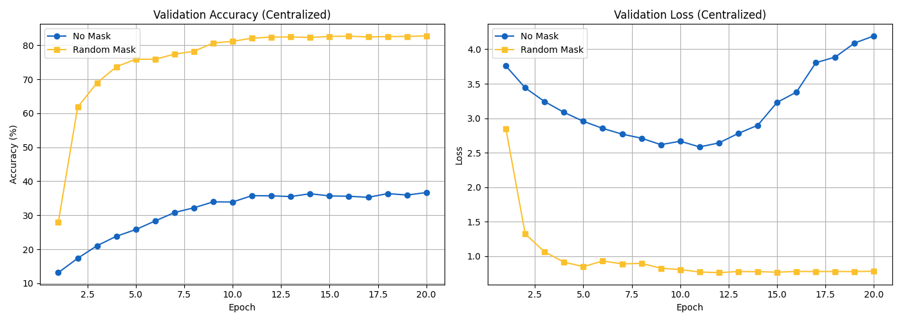
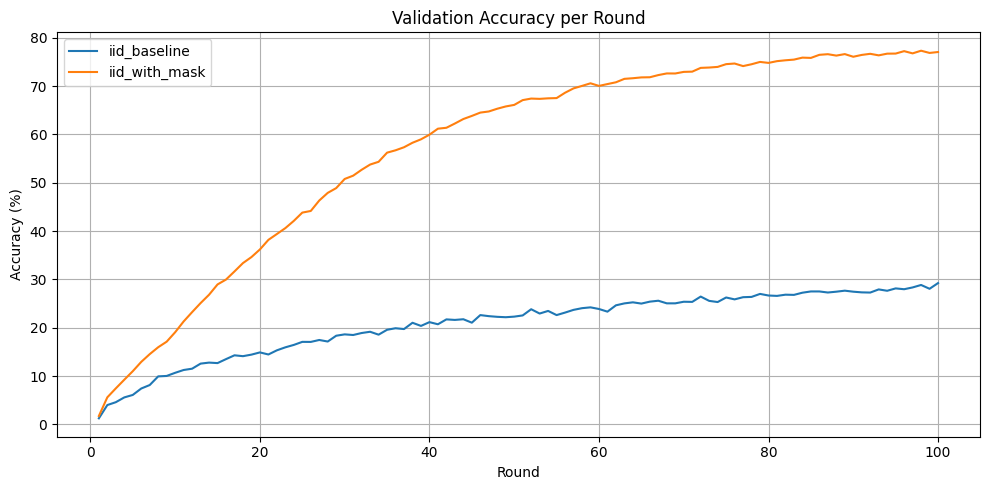
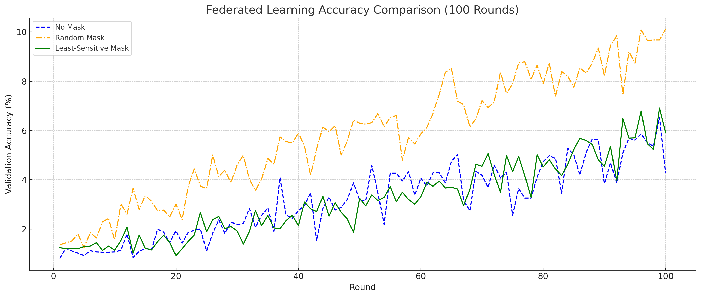

# Sparse Updates as a Regularizer in Federated Learning


-EE4C2C?logo=pytorch&logoColor=white)


Course project for **Machine Learning and Deep Learning** at **Politecnico di Torino** (Project 5: *Federated Learning Under the Lens of Model Editing*, 2025).

We fine-tune a self-supervised **DINO ViT-S/16** on **CIFAR-100** with **Federated Averaging (FedAvg)** and study how **sparse gradient masking**, a model-editing technique that updates only a subset of weights, behaves in centralized, IID-federated and extreme Non-IID-federated training.

📄 **Full report:** [`docs/report.pdf`](docs/report.pdf)

---

## Highlights

- Built a FedAvg simulator in PyTorch: 100 clients, partial participation, local SGD and server-side weight averaging, with IID and label-skewed (2 classes per client) data splits.
- Implemented two sparse fine-tuning strategies that zero out 70% of the gradient entries at each step:
  - **Random mask**: Bernoulli mask, resampled for every client in every round.
  - **Least-sensitive (Fisher) mask**: diagonal Fisher Information, only the 30% least-sensitive weights are updated.
- Added **loss-based client selection**: each round, sample 20 clients and train the 10 with the highest local loss.
- Ran a small hyperparameter sweep over client participation `C` and local epochs `J` in the Non-IID setting.
- **Main observation:** in our runs, random gradient masking beat the dense baseline by a wide margin in every setting (centralized 36.7% → 82.8%, IID 29.3% → 77.4%). The Fisher mask gave no clear gain over the baseline. See [Known issues](#known-issues--lessons-learned) for caveats.

## My contribution

This was a four-person team project. I (**Temur Kuchkorov**) wrote all of the code in this repository and ran all of the experiments:

- **Federated learning pipeline:** FedAvg simulation with client sampling, local training and server-side aggregation, plus the IID and Non-IID (2 classes per client) data splits.
- **Model setup:** loading the pre-trained DINO ViT-S/16 backbone and adding a linear classification head for CIFAR-100.
- **Sparse fine-tuning:** gradient masking with a random (Bernoulli) mask and with a least-sensitive mask based on Fisher Information.
- **Client selection:** each round, training the clients with the highest local loss.
- **Experiments:** all centralized, IID and Non-IID runs and the C/J hyperparameter sweep, including logging the metrics and making the plots.

The report ([`docs/report.pdf`](docs/report.pdf)) was written by the whole team.

## Results

All numbers are top-1 accuracy (%) on CIFAR-100. The report's Table 1 does not always use the same metric for each row, so the table below shows exactly what the logs in this repository contain.

| Setting | Report (Table 1) | Logged in this repo |
|---|---:|---|
| Centralized, baseline | 36.67 | 36.67 val (epoch 20) |
| Centralized, random mask | **82.76** | 82.76 val (epoch 20) |
| FL IID, baseline | 29.25 | 29.25 test |
| FL IID, random mask | **77.05** | 77.40 test · 77.05 val (round 100) |
| FL IID, random mask + high-loss client selection | 80.53 | 80.53 test |
| FL Non-IID, baseline | 6.54 | 4.27 val at round 100 · 6.54 best round |
| FL Non-IID, random mask | **10.11** | 10.11 val (round 100) |
| FL Non-IID, Fisher least-sensitive mask | 6.91 | 5.92 val at round 100 · 6.91 best round · 6.31 test |

<details>
<summary><b>Non-IID hyperparameter sweep (10 rounds only)</b></summary>

| C (participation) | J (local epochs) | Mask | Test acc. |
|---:|---:|---|---:|
| 0.1 | 4 | random | 3.98 |
| 0.2 | 4 | random | 4.18 |
| 0.5 | 4 | random | 5.12 |
| 0.1 | 8 | not recorded | 1.48 |
| 0.1 | 16 | not recorded | 1.68 |

These are short 10-round runs, so they should not be compared directly with the 100-round results above. Only the result files of these runs are in the repo (`non_iid/results_j*`), not the notebooks that produced them.
</details>

| Centralized | FL, IID | FL, Non-IID |
|:---:|:---:|:---:|
|  |  |  |

## Method

**Model.** DINO ViT-S/16 backbone (pre-trained, self-supervised on ImageNet) with a linear head for 100 classes. The whole network is fine-tuned.

**Federated protocol.** In each of `T = 100` rounds, the server samples `C·K = 10` of `K = 100` clients. Each client copies the global model, trains for `J = 4` local epochs, and returns its weights. The server averages them with equal weights (FedAvg).

**Sparse gradient masking.** After `loss.backward()` and before `optimizer.step()`, each gradient is multiplied element-wise by a binary mask `M`:

```python
for name, p in model.named_parameters():
    p.grad *= mask[name]          # 1 = update, 0 = keep frozen
```

| Strategy | How `M` is built | Kept |
|---|---|---|
| Random | `M ~ Bernoulli(0.3)`, resampled per client per round (per epoch in centralized training) | ~30% |
| Least-sensitive (Fisher) | Diagonal Fisher `F_ii = E[(∂ℓ/∂θ_i)²]` estimated once on 2,000 held-out images; keep weights whose `F_ii` is below the 30th percentile | 30% |

**Client selection.** Each round, 20 candidate clients are evaluated on their local data, and the 10 with the highest loss are trained.

**Training setup**

| | Value |
|---|---|
| Data | CIFAR-100: 40k train / 10k val (random split of the training set) / 10k test; resized to 224×224 with ImageNet normalization |
| Optimizer | SGD, lr = 1e-3, momentum = 0.9, constant LR |
| Batch size | 32 (FL), 64 (centralized and client selection) |
| Clients | K = 100, C = 0.1, J = 4, 100 rounds |
| Non-IID split | 2 classes per client |

## Repository structure

```
.
├── centralized/
│   ├── centralized_baseline.ipynb               # dense fine-tuning
│   ├── centralized_random_mask.ipynb            # fine-tuning with random gradient mask
│   ├── centralized_baseline/  centralized_masking/   # per-epoch val accuracy / loss (JSON + plots)
│   └── centralized_mask_vs_baseline.png
├── iid/
│   ├── iid_baseline.ipynb                       # FedAvg, IID split
│   ├── iid_random_mask.ipynb                    # FedAvg + random mask
│   ├── iid_random_mask_client_selection.ipynb   # + high-loss client selection
│   ├── results_iid/  results_iid_with__mask/    # per-round metrics, final test metrics
│   └── accuracy_comparison.png  loss_comparison.png
├── non_iid/
│   ├── non_iid_baseline.ipynb                   # FedAvg, 2 classes per client
│   ├── non_iid_random_mask.ipynb                # + random mask
│   ├── non_iid_fisher_mask.ipynb                # + least-sensitive Fisher mask
│   ├── result_baseline/  results_mask/  results_j4X_with_sensitive_mask/
│   ├── results_j4X_with_mask_c0{1,2,5}/  results_j8/  results_j16/   # C / J sweep
│   └── comparison_accuracy.png  comparison_*_epoches.jpg
├── docs/
│   └── report.pdf                               # final project report
└── requirements.txt
```

## How to run

The notebooks were run on **Google Colab / Kaggle with a GPU**. One 100-round federated run takes about 3.5 hours.

1. Open a notebook in Colab (*File → Upload notebook*) and select a GPU runtime.
2. Run all cells. The first cell clones [facebookresearch/dino](https://github.com/facebookresearch/dino) and changes into it (for `vision_transformer.py`). CIFAR-100 and the DINO weights download automatically.
3. Metrics are saved as JSON/TXT, and plots as PNG, in a `results_*` folder in the working directory.

To run locally:

```bash
python -m venv .venv && source .venv/bin/activate
pip install -r requirements.txt
jupyter notebook
```

The Colab-only cells (`from google.colab import files`) just download the results archive and can be skipped.

## Known issues & lessons learned

We found these issues when reviewing the code after submission. They don't change the code that produced the logged results, but they matter when reading the numbers.

1. **The Non-IID clients are tiny.** In `split_dataset`, each time a class is assigned to a client, the client takes `len(remaining) // num_clients` images of that class. As a result, every client ends up with only **~6–8 images**, and only about 700 of the 40,000 training images are used. The very low Non-IID accuracy therefore comes mostly from data starvation, not only from label skew. The usual fix is a shard split: sort the data by label, cut it into `2·K` shards, and give each client 2 shards.
2. **Masking also reduces the step size.** Zeroing 70% of gradient entries also shrinks the effective update. Without a dense baseline at a lower learning rate, we can't tell how much of the gain comes from regularization and how much from a smaller effective learning rate. The rising validation loss of the dense centralized baseline after epoch 11 suggests that lr = 1e-3 with full fine-tuning was too aggressive.
3. **The report mixes metrics.** Some Table 1 rows report the best or final validation accuracy, not test accuracy (see the Results table).
4. **Single unseeded run per setting**, so the results are not exactly reproducible and have no error bars.
5. **The IID notebooks apply training augmentation (random crop/flip) to the validation and test sets too**, because a single transform is used for all splits.
6. **The centralized runs stopped after 20 of the planned 100 epochs.**
7. **The report and the code differ in two places.** The report mentions a cosine LR schedule and a random mask resampled every local epoch. The federated code uses a constant LR and one mask per client per round.

## Team

| | |
|---|---|
| Javokhirbek Parpikhodjaev | [@pilotparpikhodjaev](https://github.com/pilotparpikhodjaev) |
| Temur Kuchkorov | [@SpaceDevEngineer](https://github.com/SpaceDevEngineer) |
| Temurbek Karimov | [@timchenko69](https://github.com/timchenko69) |
| Bekzod Kadirov | [@bekker18](https://github.com/bekker18) |

Original team repository: [pilotparpikhodjaev/ML_DL_FEDERATED_LEARNING_PROJECT](https://github.com/pilotparpikhodjaev/ML_DL_FEDERATED_LEARNING_PROJECT)

## References

- McMahan et al., *Communication-Efficient Learning of Deep Networks from Decentralized Data* (FedAvg), AISTATS 2017
- Caron et al., *Emerging Properties in Self-Supervised Vision Transformers* (DINO), ICCV 2021
- Kirkpatrick et al., *Overcoming Catastrophic Forgetting in Neural Networks* (EWC / Fisher Information), PNAS 2017
- Iurada et al., *Efficient Model Editing with Task-Localized Sparse Fine-tuning*, ICLR 2025
- Zhao et al., *Federated Learning with Non-IID Data*, arXiv:1806.00582
